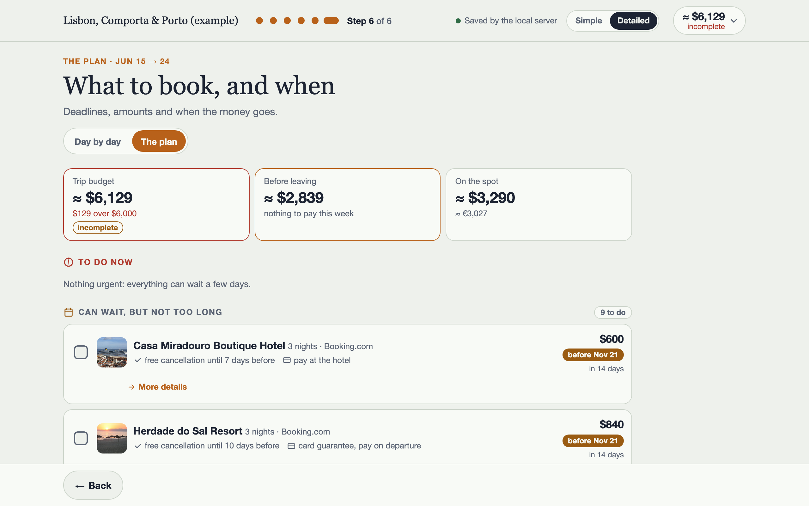

# Trip planner

Tell Claude where you want to go, for how long and with how much money. It asks a few questions, then looks up
lodgings, flights, activities and restaurants for you, with photos and real prices. You pick what you like on a
step-by-step page, and the total is always shown against your budget. At the end you get a day-by-day plan.

It works for any destination and any travelers. Everything stays on your computer.



*Example trip with invented data. The photos are Creative Commons images from Wikimedia Commons; authors and licenses
are listed in [examples/sample-trip/research/photo-credits.json](examples/sample-trip/research/photo-credits.json).*

## Requirements

- A **Claude Pro or Max subscription** (the free Claude plan does not include Claude Code).
- A **Mac or a Linux computer**. On Windows, use WSL (Windows Subsystem for Linux, a Linux inside Windows): this is
  documented but not tested.
- An internet connection.
- About 5 minutes for the first setup. The tool itself costs nothing; see [Services and costs](#services-and-costs).

Node.js 18 or newer, `uv`, Python 3.9 or newer and Pillow (an image library) are also needed. You do not have to
install them by hand: Claude checks for them at the first launch and offers to install what is missing, with the
official installers (Homebrew is not needed). The `python3` that comes with a Mac is enough.

## Install

**1. Install Claude Code**, the program that runs Claude in your terminal (the text window of your computer: Terminal
on a Mac). Follow the official page, <https://code.claude.com/docs/en/setup>. On a Mac or Linux, it comes down to one
line:

```
curl -fsSL https://claude.ai/install.sh | bash
```

(Commands on that page checked on 2026-11-07. If it has changed, the official page wins.)

**2. Download this tool and start it.** Open a terminal and type these three lines, one at a time:

```
git clone https://github.com/lsidore/trip-planner.git
cd trip-planner
claude
```

The first time, `claude` asks you to sign in with your Claude account. Then it asks whether you trust the
`trip-planner` folder: choose yes (this lets it use the tool's settings and its free search tools; if it also asks
about the project's MCP servers, accept them; if it asks whether Claude may use your browser, answer yes). Claude
then waits for you to write first: type anything, for example `Plan me a trip` or `/start`, and press Enter.

On a Mac with nothing installed yet, the first time you type `git clone` a pop-up offers to install the "Command Line Tools". Click **Install**, then **Agree**, and wait a few minutes. That one install gives you `git` and `python3` too. When it ends, type the line again.

**Prefer clicking to typing?** Open the same `trip-planner` folder in the Code tab of the
[Claude desktop app](https://claude.com/download): there, every question and every choice appears as a small screen
you click (cards, dates, a budget slider), right in the conversation. In the terminal, the same choices come as
buttons you pick with the arrow keys.

## First launch

After your first message, Claude notices that nothing is set up yet and guides you, one short step at a time:

1. It tells you what is going to happen. Nothing to pay.
2. It checks that Node.js, uv, Python, Pillow and Claude Code are there. For anything missing it proposes the command
   or the official installer and asks your OK. If a command needs your computer password, it asks you to type it
   yourself. After an install it asks you to quit Claude Code and start it again from a new terminal window
   (`claude --continue` picks the conversation up where it was), so that the new tools are found.
3. It tests the free tools (flight search, hotel prices, weather, exchange rates...).
4. It asks three quick questions on one screen you click (buttons in the terminal), and "not now" is always a fine
   answer: the tool works without any of them.
   - **Services with a key**: one list, you pick the ones you want (or none). For each one you pick, it gives the
     sign-up link and you paste the key in the chat.
   - **Claude account connectors** (Booking.com, Expedia, Tripadvisor...): it tells you which ones are already on and
     gives the link and the clicks for the others.
   - **Chrome**: it tests the Claude in Chrome extension by itself (it opens and closes a test tab). If the extension
     is not there, it shows you how to add it, in two minutes (see [docs/tools.md](docs/tools.md#4-browser-claude-in-chrome)).
5. It saves "setup done" in a hidden folder (`.setup/`). The next launches go straight to your trips.

You can redo this at any time by typing `/setup`.

## Plan me a trip

When the setup is over, type this sentence (any language works, Claude answers in yours):

```
Plan me a trip
```

Claude shows one screen to fill in with a few clicks: who travels, from where, when, the budget, what you enjoy and
how you like to sleep. From there it proposes destinations if you have none (cards to compare), then itineraries
(drawn as timelines), then searches lodgings, flights, activities and restaurants. It shows photos first, then the
options as cards: you click the ones you like. The budget is a live screen too, with a slider for what you spend on
the spot. Between two steps, a "what next" screen lets you click the next step. You can always type your answer
instead, in your own words.

You can ask for anything at any time ("cheaper hotels in the second city", "move one day", "show me the page").
The `/` commands (type `/` to see the list) are only shortcuts.

## Try the example

Want to see the result before planning your own trip? An invented trip (Lisbon, Comporta and Porto) comes with the tool.

**The simplest way:** in the Claude session, type

```
Show me the example
```

Claude builds the page, starts it and gives you the address to open: <http://127.0.0.1:8793/>.

**By hand:** open a **second terminal window** (a new Terminal window on a Mac) and go to the folder with
`cd trip-planner`. Do not type these in the Claude session: there, they would be sent to Claude as a message. In the
new window, type the two lines one at a time:

```
python3 scripts/build.py --trip examples/sample-trip
python3 scripts/server.py --trip examples/sample-trip
```

The first builds the page. The second serves it on your own computer only and keeps running: it does not give the
prompt back. Open <http://127.0.0.1:8793/> in your browser, and press `Ctrl+C` in that window when you are done.

Photos are not included in the repository, so the example shows empty picture areas. To get them, add `--photos` to
the first command. That first build with photos takes a few minutes and needs an internet connection (the photos are
downloaded).

## Services and costs

The tool uses outside services to find real prices and places. They come in four kinds. Prices and free limits change:
the exact list is in [setup/services.json](setup/services.json) (the limits of the free tiers were verified on 2026-11-07), and [docs/tools.md](docs/tools.md) explains
each one.

| Kind | What it is | Cost |
|---|---|---|
| **Free, no account** | 13 tools already switched on: flights (Kiwi), hotels (trivago), tours (Viator, Civitatis), villas (Airbnb), web search and reading, weather, exchange rates, time zones, step-by-step reasoning | Free |
| **Free tier, with a key** | Optional: SerpApi, Apify, Google Maps, Brave Search, Exa, Firecrawl. Each one has its own sign-up. A key is a long password the service gives you | Each has a free monthly allowance; some ask for a card |
| **Claude account connectors** | Optional: Booking.com, Expedia, GetYourGuide, Tripadvisor, AccuWeather; if you want them, Google Calendar, Gmail, Google Drive, Yelp, Resy, Uber, Ticketmaster, StubHub, and OpenBnB (a paid Airbnb backup). You switch them on in your Claude account settings | Free to connect, except OpenBnB (prepaid credit, Claude asks first); each service has its own terms |
| **Browser** | Optional: Claude in Chrome, to read sites that have no tool (Trip.com, Agoda, airlines) in your own Chrome. Claude tests it at setup | Free extension; needs a paid Claude plan |

Your Claude subscription also has usage limits: a long search by several agents uses a good share of them (see the FAQ).

The tool **never books or pays anything**. It searches and compares.

## FAQ

**Where is my data?**
In the `trips/` folder of this tool, on your computer. Each trip has its own folder (`trips/<name>/`) with your brief,
the research, the page and your choices. API keys are in a hidden `.env` file in the same folder. Git ignores both:
they are never uploaded.

**How do I pick up a trip where I left it?**
Start `claude` in the `trip-planner` folder and type "resume my trip". Claude lists your trips, reads your choices and
tells you where things stand.

**How do I add a key later?**
Type `/setup`, or say "I want to add my Brave key". Claude gives you the sign-up link, then saves the key for you
(you can paste it in the chat, or in the `.env` file). Restart Claude Code afterwards so it loads the new tool.

**How do I update the tool?**
Type `/update`. Claude fetches the latest version, keeps any change you made, runs the tests and tells you what is new.
Your trips are never touched.

**What are the usage limits?**
Your Claude plan limits how much you can do in a few hours. The tool is designed to fit a Pro plan: cheaper models for
the research, 3 to 5 options per stage, one research round. Before a long search Claude tells you what will run. If a
limit stops the work, the files written so far stay, and you resume later.

**Is my information private?**
See [Privacy](#privacy). The page runs on your own computer; the tool itself sends none of your trip anywhere. What
leaves your computer: the searches Claude makes for you (which contain dates, places and budget, as any search would),
and the page's fonts, which your browser loads from Google Fonts when you open the page.

**How do I contribute?**
Type `/contribute` after an improvement that would help every trip. Claude checks that no personal detail is inside,
shows you exactly what would be sent, and sends it only after your yes. See [CONTRIBUTING.md](CONTRIBUTING.md).

**How does it work inside?**
See [docs/architecture.md](docs/architecture.md). The file formats are in [docs/trip-format.md](docs/trip-format.md)
and [docs/research-format.md](docs/research-format.md).

## Privacy

- Your trips (`trips/`) and your keys (`.env`) never leave your computer through git: both are ignored.
- The page server listens on your computer only (127.0.0.1), without a password. The page loads its two fonts
  from Google Fonts (the request carries no trip data).
- A contribution is made of code and documentation only. `/contribute` runs a privacy check (names, e-mails, paths,
  keys), shows you the result and sends nothing without your explicit yes.
- Sharing a page with someone (`/share`) is your choice, each time.

## Known limitations

- **Children** are not modeled separately in this version. Count them as travelers and write their ages in the brief:
  Claude then looks for child fares and family rooms.
- **Windows** works only through WSL, and is documented but not tested.
- **Videos** of places and the import of TikTok or Instagram reels are not part of this version.
- The tool never books or pays anything: it finds, compares and plans. You book yourself, on the sites it links to.
- Prices and availability change by the minute. Everything dated carries its source and the day it was checked; check
  again before you book.

## License

[MIT](LICENSE). The example photos keep their own Creative Commons licenses.
